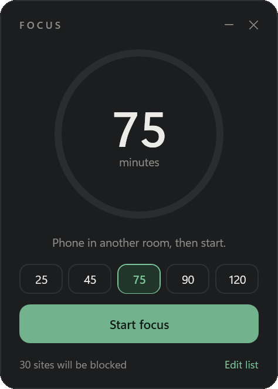
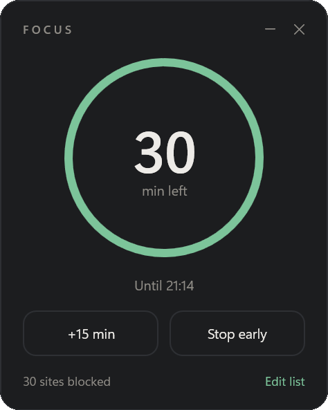
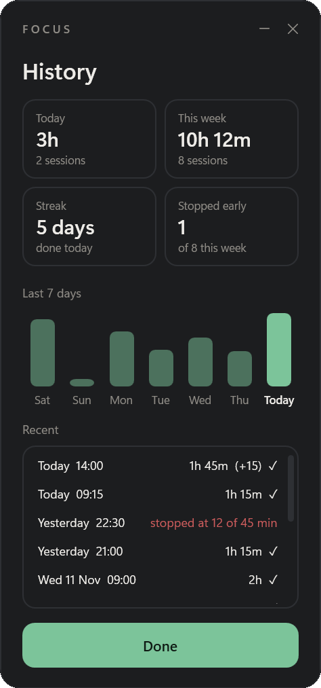

# Focus

A small Windows app that blocks distracting websites for a set time.

Pick a length and press **Start focus**. YouTube, Instagram, Reddit and the other sites on your list stop loading in every browser until the timer runs out. Stopping early is possible, but you have to type a sentence first, so it's a decision rather than a reflex.

<p>
  
  &nbsp;
  
</p>

- Preset lengths: 25, 45, 75, 90 and 120 minutes. You can add 15 minutes during a session.
- The block keeps going if you close the window, reboot or the laptop sleeps, and it turns itself off when the time is up.
- Follows the Windows light or dark theme.
- One 140 KB setup file, with nothing else to install. It needs Windows 10 or 11.

## Install

1. Download **`FocusSetup.exe`** from the [Releases](../../releases) page.
2. Open it and click **Install**, then approve the admin prompt.
3. Focus opens. Next time, find it in the Start menu or on the desktop.

Admin is needed once, because only an administrator can change the hosts file. After that the app runs as a normal user.

The setup file isn't code-signed, so Windows SmartScreen may say *"Windows protected your PC"*. Click **More info → Run anyway**.

Running `FocusSetup.exe` again updates an existing install and keeps your block list. For a silent install, run `FocusSetup.exe --install`; add `--reset-sites` to restore the default list or `--no-desktop` to skip the desktop shortcut.

### Build it yourself

```
install.cmd
```

This compiles `dist\FocusSetup.exe` from source with the C# compiler that ships with Windows (`src\build.ps1`), then opens it.

## Change the block list

Click **Edit list** in the app to see the list. Type or paste a site and press **Add**; full URLs like `https://www.reddit.com/r/all` are trimmed to `reddit.com`. Hover over a site to remove it. `www.` is blocked automatically.

During a session, sites you add are blocked straight away. Sites you remove stay blocked until the session ends, so removing one can't be used as a way out.

The default list is in [`sites.txt`](sites.txt).

## History



Click **History** to see:
- focused time today and this week
- your streak: days in a row with at least one completed session
- how often you stopped early
- a bar chart of the last 7 days
- your recent sessions

Each session is recorded by the background task, so the history stays accurate whether you started from the app or the command line, and through a reboot. The records are in `C:\ProgramData\FocusBlock\history.csv`, one row per session:

```
start,end,planned_min,final_min,actual_min,outcome
2026-11-13T14:00:00,2026-11-13T15:45:00,90,105,105,completed
2026-11-12T22:30:00,2026-11-12T22:42:00,45,45,12,stopped
```

`final_min` includes any +15 extensions.

<br clear="right">

## Command line

```powershell
powershell -File C:\ProgramData\FocusBlock\focus.ps1 75       # focus for 75 minutes
powershell -File C:\ProgramData\FocusBlock\focus.ps1 status
powershell -File C:\ProgramData\FocusBlock\focus.ps1 stop     # asks for the sentence
```

## How it works

| Piece | What it does |
|---|---|
| `C:\ProgramData\FocusBlock\request.txt`, `sites.txt` | The session's end time and the block list. These are the only files a normal user can write; the scripts and the app are admin-only. |
| Scheduled task **FocusBlock** (runs as SYSTEM every minute and at startup) | Runs `engine.ps1`. While the end time is in the future, it adds `0.0.0.0` entries for your sites to the hosts file, inside a `# FocusBlockStart` / `# FocusBlockEnd` section. Otherwise it removes that section. Nothing else in the hosts file is touched. |
| `Focus.exe` | The window. It writes `request.txt` and triggers the task so a change applies straight away. |

## Good to know

- **Reload or close tabs that are already open** on a blocked site when you start. A page that was already loaded can keep working for a little while.
- Works in browsers that respect the Windows hosts file, which includes Chrome, Edge, Vivaldi and Brave by default. A browser that resolves DNS on its own and skips the hosts file, as some Firefox DNS-over-HTTPS setups do, won't be blocked.
- It's a commitment device, not a lock. An admin can always remove it. The goal is to add enough friction to break the habit.
- The phone is not covered. Put it in another room.

## Uninstall

Go to **Settings → Apps → Installed apps → Focus → Uninstall**, or run `uninstall.cmd`. This removes the block, the scheduled task, the app and the shortcuts.

Uninstalling is refused while a session is running. Wait for the session to end.

## License

[MIT](LICENSE)
